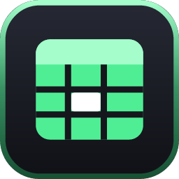

<p align="center">
  
</p>

<h1 align="center">Local Sheets</h1>

<p align="center">
  A desktop spreadsheet for Windows and Linux. It opens and saves <code>.xlsx</code>, works offline,
  needs no account, and is written in Rust, interface included.<br>
  <a href="https://github.com/Anon5T4R/local-sheets/releases/latest">Download</a> ·
  <a href="ROADMAP.md">Roadmap and status</a> ·
  <a href="#where-it-comes-from">Where it comes from</a> ·
  <a href="#how-it-is-made">How it is made</a>
</p>

<!-- screenshot: a sample workbook with a formatted table, a chart and the formula bar in use; dark and light -->

## What it does

- **Write and edit.** A ribbon, a formula bar that points at cells while you build a formula (type
  `=SUM(` and click the range), the Name Box, sheet tabs, a fill handle, in-cell editing, Format
  Cells, Paste Special, Find and Replace, and Flash Fill.
- **Calculate.** A dependency-graph engine with dynamic arrays and spilling, LET and LAMBDA with the
  functions that take one (MAP, REDUCE, SCAN, BYROW, BYCOL, MAKEARRAY), structured table
  references, iterative calculation, and the worksheet function families Excel users look for:
  lookup, text, date, statistics, financial, engineering and database.
- **Format.** Cell styles and themes, borders, conditional formatting (rules, data bars, colour
  scales, icon sets), table styles, and pictures inside a cell as well as floating over the grid.
- **Analyse.** Sort, AutoFilter and Advanced Filter, Text to Columns, Remove Duplicates, data
  validation, outlines and subtotals, PivotTables with a field list, Goal Seek, Solver (linear,
  nonlinear and evolutionary), the Data Analysis tools, and what-if scenarios and data tables.
- **Chart.** Columns and bars, line, area, pie, doughnut, scatter, bubble, radar, histogram,
  waterfall, funnel, treemap, sunburst, box and whisker, stock and combo charts, with a Chart Design
  tab and a format pane.
- **Print and export.** Page setup, Page Break Preview, printing through the system spooler, and a
  self-contained PDF writer (the active sheet, or every sheet of the workbook).
- **Automate.** Everything the app does to a workbook is a command with undo, and the ribbon, the
  keyboard, the CLI and MCP all run the same command ids. A command search finds any of them.
  Macros are typed lists of those same commands (recorded or written by hand), not VBA.
- **Work in your window.** Each workbook opens in its own window; the interface is translated and
  the View tab switches the language, Spanish also switches formula entry to its Spanish names for
  the common functions, with decimal commas and semicolon separators, and the theme is Automatic,
  Light or Dark.
- **Drive it from outside.** A CLI, a JSON control channel on localhost, and an MCP server use the
  same commands a person does, headless or in the window you are looking at
  ([docs/cli.md](docs/cli.md), [docs/mcp.md](docs/mcp.md)).

## Formats

| Format | Read | Write |
| --- | --- | --- |
| `.xlsx` (native) | yes: styles, themes, formulas, tables, conditional formatting, validation, comments, links, charts, pictures, sparklines, PivotTables and print setup | yes |
| `.csv`, `.tsv` | yes | yes |
| `.txt` | yes, read as tab-separated | no |
| `.ods` | worksheet data; a formula becomes its last saved result | no |
| `.xlsb` | worksheet data; a formula becomes its last saved result | no |
| `.xls` (Excel 97–2003) | partial: values, formulas, number formats, cell formatting, merges, row and column sizes, names and print setup; charts, pictures, comments, conditional formats and validation are skipped with a warning | no |
| `.slk` (SYLK) | values, formulas and number formats | no |
| `.html` | a page's table, opened as a sheet | yes (Save as Web Page) |
| `.pdf` | — | yes: the active sheet, or every sheet |
| `.xlsx` with a password | yes (Agile and Standard encryption) | saved without the password |

XLSX is the native format because it is the one other tools read: the fork introduces no format of
its own. Parts of a workbook the app does not model (controls, query tables, external workbook
links and similar) are carried through a save, so opening and saving does not throw them away.

CSV fields are read like typed cell input, so `000123` is read as a number; the `file.open` command
takes `csvAsText` to keep every field as text, which matters for SKUs, GTINs and ZIP codes. Python
cells (`PY`) that a file carries are kept and saved, but this build runs no Python: new or changed
code shows `#BLOCKED!`. PDF export uses the 14 standard PDF fonts and embeds no font; characters
outside them are written in a predefined Adobe-GB1 CID font, and scripts that need shaping (Arabic,
Devanagari, Thai) are not shaped yet.

## Where it comes from

Local Sheets is a fork of [GridCraft](https://github.com/storytold/gridcraft) by
[ArtCraft](https://getartcraft.com), MIT or Apache-2.0, started from the upstream `v0.16.1` tree.
The spreadsheet engine is their work: the formula language, the calculation engine, the XLSX reader
and writer, and the decision to write all of it in Rust.

**Why a fork.** We wanted a set of desktop apps that look and behave the same, update and sign the
same way, and follow our own priorities: Windows and Linux first, files that stay local, AI only
with your own key, and agents able to drive every app. A fork lets us decide that without asking the
upstream to change direction.

We also wanted "written in Rust" to hold for everything the app runs. The updater and the AI client
reach the network through a pure-Rust TLS provider (rustls with RustCrypto, in
`libs/rustls-rustcrypto`), so `ring`, `aws-lc` and OpenSSL are not in the program you install.

**What changed here:**

- Name, icon, app and installer identifiers, and the configuration folder.
- The shell shared by all Local apps: Automatic/Light/Dark themes, settings, command search, the AI
  tab and the update prompt.
- Our own updater (a permanent fork of the suite's updater) and our own release pipeline: MSIs
  per-machine and per-user, plus a portable ZIP on Windows; AppImage, deb, rpm, tarball and an Arch
  package on Linux; all published from a tag.
- XLSX stays the native format, so files and tools from the upstream and from Excel stay
  compatible.
- Live automation of the open app goes through `craft-mcp`, shared by the Local apps.

**What we still take from upstream:** bug fixes that matter to us (crashes, data loss, security,
file compatibility), reviewed one by one and adapted. New features and UI changes are not merged
automatically. Each sync is recorded in [docs/UPSTREAM-SYNC.md](docs/UPSTREAM-SYNC.md).

## Network and privacy

- Your workbooks never leave the computer through the app.
- When it starts, the app asks GitHub whether a newer release exists and offers it. There is no
  setting to turn the check off yet; a check that fails stays in the log and says nothing.
- AI does nothing until you add a provider and your own key (see [AI](#ai)).
- No account, analytics or crash reporting.

Security notes, all checkable in this repository:

- The app's own crates and both binaries forbid `unsafe`. Lower layers do, as every desktop app's
  do: the window system (winit) and the GPU (wgpu).
- Updates and AI requests use rustls with a pure-Rust provider (RustCrypto); no C TLS library is in
  the installed program.
- A downloaded update is checked against the release's SHA-256, and a file that no published
  checksum vouches for is refused before it is installed. The minisign signature check on the
  downloaded asset is advisory today: a mismatch is logged, not blocked.
- Releases are built only by GitHub Actions from a tagged commit with locked dependencies.
  `cargo-deny` checks licenses, bans and sources, and no dependency may come from a git URL; the
  accepted advisory exceptions are written down with their reasons in
  [deny.toml](deny.toml).

## Download

Windows 10/11 (x64): an `.msi` per-machine or per-user installer, or a portable `.zip` with
`localsheets.exe` and `localsheets-cli.exe`. Linux (x86_64): `.AppImage`, `.deb`, `.rpm`, `.tar.gz`
or an Arch `.pkg.tar.zst`. All in
[Releases](https://github.com/Anon5T4R/local-sheets/releases/latest). macOS and BSD build from
source; no artifacts are published for them.

Each file is signed with [minisign](https://jedisct1.github.io/minisign/), the same key as every
Local app, and each release carries `SHA256SUMS.txt`. To check a file:

```sh
minisign -Vm <file> -P RWTqN+hTTCFbDCGCA1cEJRLp2FSluxIUiJfqdoAYwkwNNVH5MTYH8qSN
```

The `.deb` and `.rpm` depend on xkbcommon and Vulkan or EGL, and recommend the X11 and Wayland
client libraries and a desktop portal, because the app opens those when it starts; a tarball install
has to provide them itself. The lists are in
[packaging/linux/nfpm.yaml](packaging/linux/nfpm.yaml).

## Build from source

Rust 1.95 or newer.

```sh
git clone https://github.com/Anon5T4R/local-sheets
cd local-sheets
cargo run --release -p localsheets   # the app
cargo xtask ci                       # all local checks
```

The bundled fonts come from `assets/craft-fonts`, which is vendored and always embedded by the
build. On Linux the build also needs `pkg-config` and the X11, Wayland, GTK3 and xkbcommon
development packages; the CI workflow has the exact list.

## How it is made

Local Sheets follows the same rules as every Local app: local files and no account, Rust only
(including the UI and the cryptography), one self-contained repository per app, forks with selective
sync, governed dependencies, signed releases built from a tag, optional AI with your own provider,
and MCP so agents can use the app. Most of the code is written by AI coding agents (Claude Code and
OpenCode) from written plans, reviewed by the maintainer and held to the same checks and CI. The
reasons for each decision:
[How we make the Local apps](https://github.com/Styx-Studios/.github/blob/main/profile/README.md#how-we-make-the-local-apps).

## AI

The AI tab is off until you add a connection: a provider preset (Google Gemini, OpenAI, Groq,
OpenRouter, OpenCode Zen or Go, or any OpenAI-compatible endpoint), an editable base URL, a model
from the provider's own list, and your key. The key goes to the operating system's keychain, not to
a file in the repository.

It has four actions: write a table from a description, continue a column, write one formula for a
cell, and label the columns of a table so the app can apply one of its own formatting presets. An
answer is applied through the app's own commands in one undo step, so a failed apply rolls back,
and an answer that does not fit the sheet is a message, not a half-written sheet. The text you send
goes only to the provider you chose; a local server such as llama.cpp or Ollama works the same way.

## License and credits

MIT or Apache-2.0, at your option ([LICENSE-MIT](LICENSE-MIT), [LICENSE-APACHE](LICENSE-APACHE),
[NOTICE](NOTICE)). The upstream GridCraft and ArtCraft credits are kept in `NOTICE`; every bundled
font, icon and image with its author, source and license is in [ATTRIBUTION.md](ATTRIBUTION.md).
Builds embed the `craft-fonts` fonts (SIL Open Font License 1.1), listed there too.

Local Sheets is an independent app and is not affiliated with Microsoft; the Excel names in the
interface describe compatible behaviour. Other Local apps:
[the full list](https://github.com/Styx-Studios).
